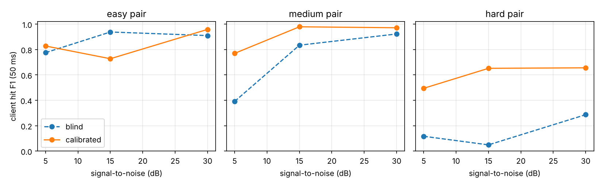
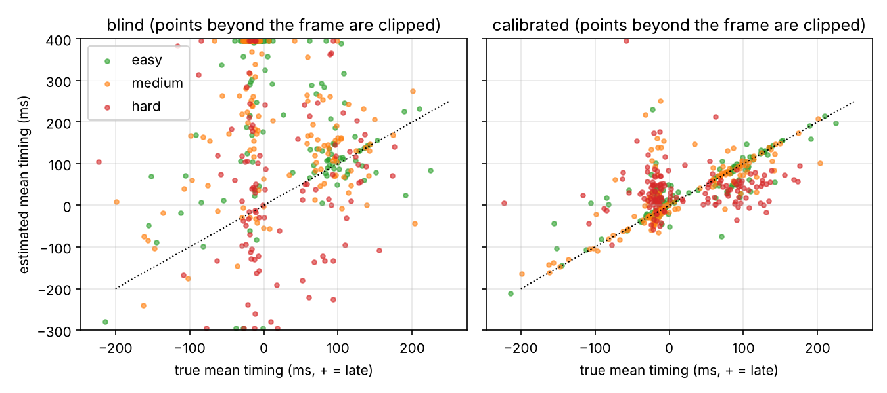

# Week 1 results: synthetic sessions

81 held-out synthetic sessions (3 instrument pairs x 3 noise levels x 3 echo levels x 3 seeds, tempo 70/100/140 bpm, half with a tempo change). Settings for the calibrated method were tuned on 12 separate dev sessions. Full tables: `tables.md`.

## Findings

1. **The standard approach fails at the moment that matters.** Blind detection finds most client hits when the instruments differ (F1 0.91 to 0.94 for drum vs shaker at 15 to 30 dB), but the timing measure is useless: median error 115 to 185 ms per segment, correlation with the truth about zero. When the client is in sync, both hits land within ~20 ms and the detector hears one hit, so the therapist's beat goes missing exactly when the client is doing well.
2. **A 3-second calibration fixes it for different-sounding instruments.** Calibrated NMF measures each segment's average timing within a median 7 ms of the truth for the easy and medium pairs (correlation 0.84 and 0.77), and the in-sync rate within 4 to 5 percentage points.
3. **Two similar drums is the open problem.** For two low frame drums, calibrated F1 is 0.49 to 0.66 and segment timing is not trustworthy (median error 55 ms, correlation 0.07). Blind is worse (F1 0.05 to 0.29).
4. **Echo hurts the therapist track most** (calibrated therapist F1 0.94 at 0.2 s RT60, 0.77 at 1.2 s).

## Caveats

- Synthetic audio is cleaner and more regular than real players and rooms. Week 2 recordings test that.
- Each cell of the noise table averages 9 sessions, so differences of ~0.1 are within noise (e.g. calibrated easy dips at 15 dB).
- The blind baseline is given the right cluster labels from the answer key, so its real-world numbers would be no better than these.
- Not yet measured: tempo following, voice, and turn-taking.

## Next

- Week 2: record acted sessions (protocol in the README) and rerun the same measures against the close-phone answer key.
- Try to fix the similar-drums case: more templates per instrument, using the therapist's steady beat as a prior, or a second phone.
